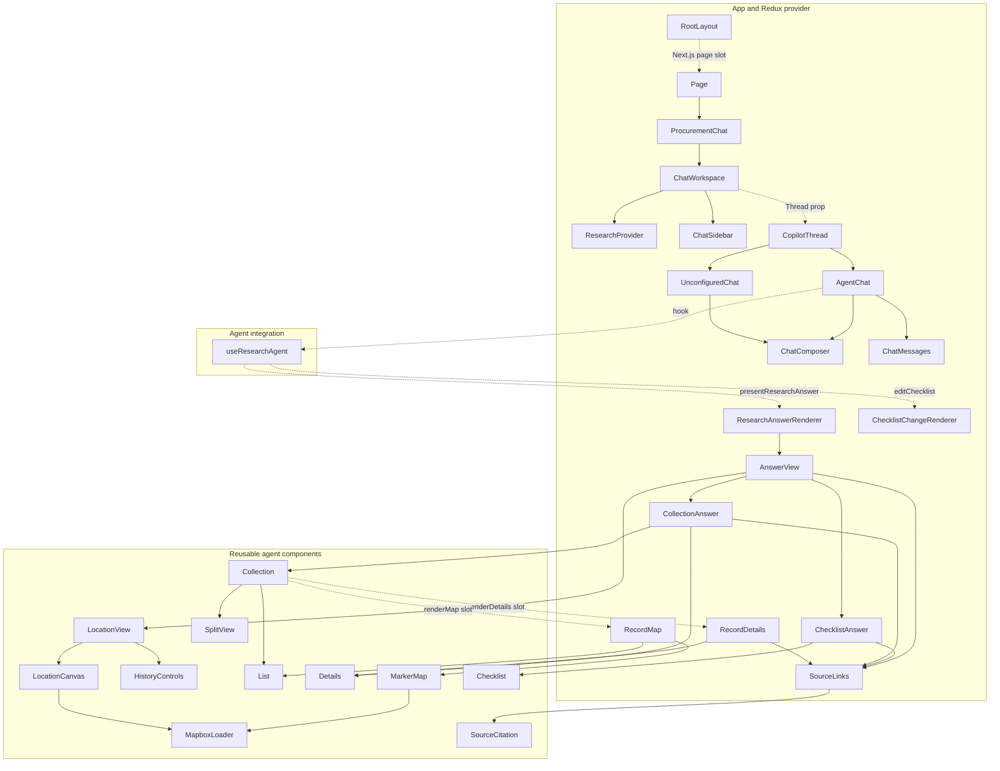

# Frontend component connections

Generated from TypeScript symbols and JSX in the current working tree. No application files were changed.

**30 components and 1 integration hook; 0 unreachable nodes from the Next.js page/layout entry points.**

Solid arrows are direct JSX rendering. Dotted arrows are framework, component-prop, render-slot or CopilotKit tool connections. Third-party SDK components and native HTML elements are omitted.

## Indirect connections that can look unused

- ProcurementChat supplies CopilotThread as ChatWorkspace's Thread prop. It is not a direct JSX import in ChatWorkspace.
- AgentChat calls useResearchAgent, which registers ResearchAnswerRenderer and ChecklistChangeRenderer with CopilotKit. The SDK invokes them through renderToolCall when a corresponding tool call exists.
- CollectionAnswer supplies RecordDetails and RecordMap through Collection's renderDetails/renderMap callbacks. These are conditional on the requested layout and view.
- RootLayout receives Page through Next.js's children slot.

## When branches run

| Branch | Trigger |
|---|---|
| UnconfiguredChat | Server Gemini key is missing |
| AgentChat | Gemini configuration exists |
| ResearchAnswerRenderer | Agent calls presentResearchAnswer |
| ChecklistChangeRenderer | Agent calls editChecklist |
| CollectionAnswer | Approved output kind is collection |
| ChecklistAnswer | Approved output kind is checklist |
| LocationView | Approved output kind is location |
| RecordDetails / SplitView | Collection uses split layout and has visible items |
| RecordMap | Map view for a supported collection |
| MarkerMap | Map access exists and locations resolve |
| HistoryControls | Historical imagery mode with a resolved location |
| SourceCitation | A source first appears in supported answer text or details |

## Reachability inventory

| Component / hook | Definition | Static status |
|---|---|---|
| MapboxLoader | [src/components/agent/map/MapboxLoader.tsx:3](../src/components/agent/map/MapboxLoader.tsx#L3) | Reachable |
| LocationCanvas | [src/components/agent/location/LocationCanvas.tsx:14](../src/components/agent/location/LocationCanvas.tsx#L14) | Reachable |
| RootLayout | [src/app/layout.tsx:5](../src/app/layout.tsx#L5) | Reachable |
| SourceCitation | [src/components/agent/sources/SourceCitation.tsx:9](../src/components/agent/sources/SourceCitation.tsx#L9) | Reachable |
| SourceLinks | [src/components/app/evidence/SourceLinks.tsx:4](../src/components/app/evidence/SourceLinks.tsx#L4) | Reachable |
| HistoryControls | [src/components/agent/location/HistoryControls.tsx:5](../src/components/agent/location/HistoryControls.tsx#L5) | Reachable |
| LocationView | [src/components/agent/location/LocationView.tsx:9](../src/components/agent/location/LocationView.tsx#L9) | Reachable |
| SplitView | [src/components/agent/SplitView.tsx:3](../src/components/agent/SplitView.tsx#L3) | Reachable |
| List | [src/components/agent/List.tsx:13](../src/components/agent/List.tsx#L13) | Reachable |
| Collection | [src/components/agent/Collection.tsx:17](../src/components/agent/Collection.tsx#L17) | Reachable |
| Details | [src/components/agent/Details.tsx:4](../src/components/agent/Details.tsx#L4) | Reachable |
| RecordDetails | [src/components/app/details/RecordDetails.tsx:10](../src/components/app/details/RecordDetails.tsx#L10) | Reachable |
| MarkerMap | [src/components/agent/map/MarkerMap.tsx:12](../src/components/agent/map/MarkerMap.tsx#L12) | Reachable |
| RecordMap | [src/components/app/answers/RecordMap.tsx:8](../src/components/app/answers/RecordMap.tsx#L8) | Reachable |
| CollectionAnswer | [src/components/app/answers/CollectionAnswer.tsx:19](../src/components/app/answers/CollectionAnswer.tsx#L19) | Reachable |
| Checklist | [src/components/agent/Checklist.tsx:12](../src/components/agent/Checklist.tsx#L12) | Reachable |
| ChecklistAnswer | [src/components/app/answers/ChecklistAnswer.tsx:14](../src/components/app/answers/ChecklistAnswer.tsx#L14) | Reachable |
| AnswerView | [src/components/app/answers/AnswerView.tsx:15](../src/components/app/answers/AnswerView.tsx#L15) | Reachable |
| ResearchAnswerRenderer | [src/components/app/AnswerRenderer.tsx:13](../src/components/app/AnswerRenderer.tsx#L13) | Reachable |
| ChecklistChangeRenderer | [src/components/app/AnswerRenderer.tsx:20](../src/components/app/AnswerRenderer.tsx#L20) | Reachable |
| ChatComposer | [src/components/app/ChatComposer.tsx:9](../src/components/app/ChatComposer.tsx#L9) | Reachable |
| ChatMessages | [src/components/app/ChatMessages.tsx:4](../src/components/app/ChatMessages.tsx#L4) | Reachable |
| useResearchAgent | [src/components/app/useResearchAgent.tsx:10](../src/components/app/useResearchAgent.tsx#L10) | Reachable |
| ResearchProvider | [src/store/Provider.tsx:7](../src/store/Provider.tsx#L7) | Reachable |
| ChatSidebar | [src/components/app/ChatSidebar.tsx:5](../src/components/app/ChatSidebar.tsx#L5) | Reachable |
| ChatWorkspace | [src/components/app/ChatWorkspace.tsx:15](../src/components/app/ChatWorkspace.tsx#L15) | Reachable |
| UnconfiguredChat | [src/components/app/CopilotThread.tsx:12](../src/components/app/CopilotThread.tsx#L12) | Reachable |
| CopilotThread | [src/components/app/CopilotThread.tsx:18](../src/components/app/CopilotThread.tsx#L18) | Reachable |
| AgentChat | [src/components/app/CopilotThread.tsx:27](../src/components/app/CopilotThread.tsx#L27) | Reachable |
| ProcurementChat | [src/components/app/CopilotThread.tsx:58](../src/components/app/CopilotThread.tsx#L58) | Reachable |
| Page | [src/app/page.tsx:3](../src/app/page.tsx#L3) | Reachable |

## Interpretation

No current component is statically unreachable after resolving the prop and tool registrations.

Reachable means there is a code path to the component. It does not prove a Gemini response requests every output type, a map service succeeds, or that a branch was exercised in the browser. Tests are excluded as application entry points, so a test-only component would be flagged. This graph is a snapshot of the working tree.
